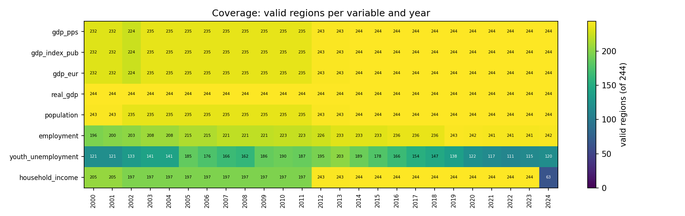

# Data

## Sources and retrieval
All data come from the Eurostat dissemination API (JSON-stat, no key) and the GISCO NUTS 2024 boundary file.
Each response was saved gzipped and unedited in `data/raw/`, with its URL, retrieval time, the dataset's own
update date and a SHA-256 hash recorded in `data/raw/manifest.json`; all later code reads only this frozen cache.

| Variable | Eurostat dataset | Filters | Unit kept | Dataset updated | Retrieved (UTC) |
|---|---|---|---|---|---|
| gdp_pps | nama_10r_2gdp | unit=PPS_EU27_2020_HAB | as filtered | 2026-02-10 | 2026-11-08 |
| gdp_index_pub | nama_10r_2gdp | unit=PPS_HAB_EU27_2020 | as filtered | 2026-02-10 | 2026-11-08 |
| gdp_eur | nama_10r_2gdp | unit=EUR_HAB | as filtered | 2026-02-10 | 2026-11-08 |
| real_gdp | nama_10r_2gvagr | na_item=B1GQ | I20 | 2026-03-23 | 2026-11-08 |
| population | nama_10r_3popgdp | none | THS | 2026-02-10 | 2026-11-08 |
| employment | lfst_r_lfe2emprt | unit=PC&age=Y20-64&sex=T | as filtered | 2026-10-30 | 2026-11-08 |
| youth_unemployment | lfst_r_lfu3rt | unit=PC&age=Y15-24&sex=T&isced11=TOTAL | as filtered | 2026-10-30 | 2026-11-08 |
| household_income | nama_10r_2hhinc | na_item=B6N&direct=BAL | PPS_EU27_2020_HAB | 2026-05-20 | 2026-11-08 |
| gva_2000 | nama_10r_3gva | unit=CP_MEUR&time=2000 | as filtered | 2026-03-23 | 2026-11-08 |

Levels and dispersion use purchasing power standards (PPS), which remove national price-level differences;
growth uses real volume indices, which are unit-free. Euro GDP per inhabitant is kept only for the euro-versus-PPS comparison.

## Universe and period
The universe is the 244 NUTS 2024 level-2 regions marked `EU_STAT = T` in the GISCO file, in 27 countries.
Historical codes, non-EU codes and country or NUTS 1 aggregates are dropped from the panel; only current codes
with Eurostat's back-calculated history are used, never spliced by hand. The period is 2000-2024 (25 years).
The brief speaks of thirty years of cohesion funding, but Eurostat's regional accounts under current codes start in
2000; earlier years would need another source (for example ARDECO) and are not spliced in silently.

## Coverage
The first step is to count how many of the 244 regions have a valid value for each variable and year
(`results/coverage.csv`; figure below). The count changes over time, so a region present in one year may be absent in another.

| Variable | 2000 | 2015 | 2024 | Lowest year |
|---|---|---|---|---|
| gdp_pps | 232 | 244 | 244 | 224 (2002) |
| gdp_index_pub | 232 | 244 | 244 | 224 (2002) |
| gdp_eur | 232 | 244 | 244 | 224 (2002) |
| real_gdp | 244 | 244 | 244 | 244 (2000) |
| population | 243 | 244 | 244 | 235 (2002) |
| employment | 196 | 233 | 242 | 196 (2000) |
| youth_unemployment | 121 | 178 | 120 | 111 (2022) |
| household_income | 205 | 244 | 63 | 63 (2024) |

Household income is available for 63 regions in 2024 against 244 in 2023. The matched income panel stops in 2023 because the 2024 release covers too few regions; 2024 is shown as a coverage note only.
Sector shares for 2000 are available for 233 regions.

## Cleaning rules
- **No imputation.** Missing values stay missing; no interpolation and no hand-edited values. A region missing any
  year is outside that balanced panel and is never filled in.
- **Flags.** Eurostat flags for estimated (e), provisional (p), break (b) and definition-differs (d) values are kept.
  Observations flagged `u` (low reliability) are dropped for the two labour variables only.
- **Special values and duplicates.** Raw responses are checked for duplicate keys with conflicting values, infinite
  values and sentinel codes (-1, -99, -999, -9999); none may be present (checked in validation). Levels must be
  positive and rates within 0-100.
- **Outliers** are flagged and examined, not removed; persistent extremes such as Ireland and Luxembourg are
  treated with explicit robustness runs in the analysis.

| Variable | Observations | Flagged (count by flag) | Dropped (flag u, labour only) |
|---|---|---|---|
| gdp_pps | 5,973 | break in time series: 100; estimated: 33; provisional: 485 | 0 |
| gdp_index_pub | 5,973 | break in time series: 100; estimated: 33; provisional: 485 | 0 |
| gdp_eur | 5,973 | break in time series: 100; estimated: 33; provisional: 485 | 0 |
| real_gdp | 6,100 | break in time series: 11; estimated: 4,525; provisional: 128 | 0 |
| population | 6,006 | break in time series: 89; provisional: 447 | 0 |
| employment | 5,667 | break in time series: 1,104; break in time series, definition differs: 70; break in time series, definition differs, low reliability: 2; break in time series, low reliability: 4; definition differs: 107; definition differs, low reliability: 2; low reliability: 22 | 30 |
| youth_unemployment | 4,834 | break in time series: 737; break in time series, definition differs: 53; break in time series, definition differs, low reliability: 15; break in time series, low reliability: 174; definition differs: 85; definition differs, low reliability: 22; low reliability: 759 | 970 |
| household_income | 5,369 | break in time series: 103; estimated: 456; provisional: 354 | 0 |

GDP break flags (b) on the PPS or real GDP series affect 54 region(s) in 7 country(ies)
(largest counts: PL (17), BE (11), HU (8), RO (8), HR (4); `results/gdp_break_flags.csv`). Regions are marked `gdp_break_flagged` in `region_reference.csv`
and are excluded in the break-sensitivity runs.

Missing data were examined descriptively (`src/explore.py`). Share of the region-year grid missing, by variable: gdp_pps 2.1%; gdp_eur 2.1%; real_gdp 0.0%; employment 7.6%; youth_unemployment 36.7%; population 1.5%; household_income 12.0%. Variables above the 3% rule of thumb for harmless deletion: employment, youth_unemployment, household_income. Where the gaps fall by country and year is in `results/exploration/missing_by_country.csv` and `missing_by_year.csv`. Missingness is not assumed to be random, and nothing is imputed.

## Sample decisions: balanced panels
Every comparison uses a balanced panel, so the set of regions never changes inside a statistic. A region is in a
panel only if every required variable is present in every year of the window. Each outcome has its own panel and
panels must not be compared as if they were one sample.

| Panel | Window | Variables required | Regions | Countries |
|---|---|---|---|---|
| main | 2000-2024 | gdp_pps, population, real_gdp | 224 | 25 |
| gdp_2010_2024 | 2010-2024 | gdp_pps, population, real_gdp | 235 | 26 |
| gdp_2015_2024 | 2015-2024 | gdp_pps, population, real_gdp | 244 | 27 |
| employment_2000_2024 | 2000-2024 | employment | 195 | 22 |
| employment_2015_2024 | 2015-2024 | employment | 231 | 27 |
| youth_2000_2024 | 2000-2024 | youth_unemployment | 43 | 17 |
| youth_2015_2024 | 2015-2024 | youth_unemployment | 96 | 22 |
| gdp_income_2000_2023 | 2000-2023 | gdp_pps, household_income | 186 | 24 |

**Main panel.** 224 regions in 25 countries, holding 93.1% of the universe's 2024 population. 20 regions are excluded
(by country: BE (11), RO (8), FR (1)):

- BE10 (Région de Bruxelles-Capitale/ Brussels Hoofdstedelijk Gewest): gdp_pps:2000-2002
- BE21 (Prov. Antwerpen): gdp_pps:2000-2002
- BE22 (Prov. Limburg (BE)): gdp_pps:2000-2002
- BE23 (Prov. Oost-Vlaanderen): gdp_pps:2000-2002
- BE24 (Prov. Vlaams-Brabant): gdp_pps:2000-2002
- BE25 (Prov. West-Vlaanderen): gdp_pps:2000-2002
- BE31 (Prov. Brabant wallon): gdp_pps:2000-2002
- BE32 (Prov. Hainaut): gdp_pps:2000-2002
- BE33 (Prov. Liège): gdp_pps:2000-2002
- BE34 (Prov. Luxembourg (BE)): gdp_pps:2000-2002
- BE35 (Prov. Namur): gdp_pps:2000-2002
- FRY5 (Mayotte): gdp_pps:2000-2013;population:2000-2013
- RO11 (Nord-Vest): gdp_pps:2002-2011;population:2002-2011
- RO12 (Centru): gdp_pps:2002-2011;population:2002-2011
- RO21 (Nord-Est): gdp_pps:2002-2011;population:2002-2011
- RO22 (Sud-Est): gdp_pps:2002-2011;population:2002-2011
- RO31 (Sud-Muntenia): gdp_pps:2002-2011;population:2002-2011
- RO32 (Bucureşti-Ilfov): gdp_pps:2002-2011;population:2002-2011
- RO41 (Sud-Vest Oltenia): gdp_pps:2002-2011;population:2002-2011
- RO42 (Vest): gdp_pps:2002-2011;population:2002-2011

All other choices (which series flag a break, the GISCO file, centroids, treatment of 2024 income) are recorded with
reasons in `DECISIONS.md`.

## Limitations
- Regional boundaries were redrawn in 2013, 2016, 2021 and 2024. Current codes with Eurostat's back-calculated
  history are used, but back-calculation can fail for some regions; this appears as missing years and as break flags.
- Output is counted where people work and population where they live, which distorts commuter regions;
  household income (residence-based) is used as a cross-check.
- Labour statistics have a survey break around 2021; the analysis reports windows that stop at 2020 and start at 2021.
- All results from these data are descriptive and associational. They do not estimate the causal effect of cohesion funding.

## Validation
11 of 11 data-layer validation checks pass (`results/validation.json`).
